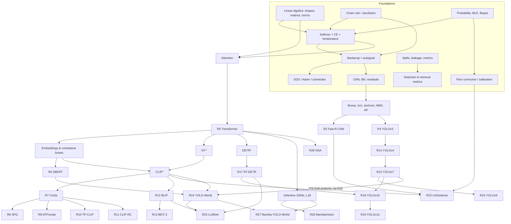

# 01 — Learning Roadmap

> Back to [README](README.md) · Paper details: [00_Paper_Inventory](00_Paper_Inventory.md) · Status: [PROGRESS](PROGRESS.md)
>
> **Version 2 (2026-10-24).** Built from the inventory *before* your diagnostic. Expect revisions once [the diagnostic](exercises/Exercise_00_Diagnostic.md) is answered. Changes are logged at the bottom of this file and in [PROGRESS](PROGRESS.md).

## 1. What the collection is actually about

The 33 papers in scope are **not** a generic ML reading list. They form a few connected sub-trees around one centre of gravity: **open-vocabulary / real-time object detection with vision-language models**.

```
                    Transformer (R5)
                 /        |          \
             CLIP*       DETR*        efficient token mixing
            /     \         \         (MambaVision R26, NSA R28)
       prompt    VL pre-   RT-DETR → YOLOv10 → YOLOv12
       learning  training  (R17)     (R18)     (R19)
       (R7–11)   (R12–13)     \        /
            \        \     YOLO lineage (R4, R14–16, R20–22)
             \        \       /
              open-vocabulary detection
              UniDetector → YOLO-World → LLMDet
                 (R23)        (R24)      (R25)
                                 \
                             Mamba-YOLO-World (R27) ← SSM math (L18)
   * = essential paper that is NOT in the folder (see inventory §2)
```

Three consequences shape the course:

1. **Two concepts carry most of the weight:** (a) *softmax-over-similarities trained with cross-entropy* (CLIP zero-shot, CoOp, ATPrompt, YOLO-World's contrastive head, attention itself) and (b) *attention / learnable queries* (Transformer, DETR, RT-DETR, BLIP, YOLOv12). Both are taught early and rigorously.
2. **Detection-specific machinery** (IoU, anchors, label assignment, NMS, AP) is needed by about 17 papers. You have used it, but the course checks the math.
3. **LoRA appears in only one paper** (MP5, peripheral). The parameter-efficient method that dominates your collection is **prompt learning** (CoOp family), so the course gives prompt learning the depth and covers LoRA compactly as part of the adaptation spectrum ([05_Advanced_Topics](05_Advanced_Topics.md), §4).

## 2. Stages at a glance

| Stage | Theme | Lessons (planned) | Papers (R#) | Exit criterion |
|---|---|---|---|---|
| **0** | Foundations rebuilt (diagnostic-driven) | L01–L05 | (R31 as a critique exercise) | Derive softmax-CE and MLP gradients by hand. Explain AdamW and a sound train/val/test protocol. Compute conv output shapes. |
| **1** | Detection fundamentals | L06 | R1, R2, R3 (selected), R4 | Compute IoU, decode YOLO boxes, run NMS and compute AP by hand. Derive the Fast R-CNN multi-task loss. |
| **2** | Attention and embeddings | L07–L08 | R5, R6 | Implement multi-head attention from scratch with correct shapes. Explain bi- vs. cross-encoders and contrastive losses. |
| **3** | Vision-language models and prompt learning | L09–L12 | *CLIP, ViT* (external), R7–R13 | Derive CoOp's gradient path. Explain base-to-novel evaluation. Compare ITC/ITM/LM objectives. |
| **4** | Real-time detection: YOLO and DETR | L13–L16 | R14, R15, R16, *DETR* (external), R17, R18, R19, R20–R22 (reference) | Explain learnable queries, label assignment (one-to-many vs. one-to-one), Hungarian matching, re-parameterisation, and why NMS-free matters. |
| **5** | Open-vocabulary detection | L17 | R23, R24, R25 | Explain region–text alignment end to end, from text prompt to box, and critique the OVD evaluation protocols. |
| **6** | Efficient token mixing (SSMs, hybrids, sparse attention) | L18–L20 | R26, R27, R28 (optional) | Discretise an SSM, explain selectivity, and explain how Mamba-YOLO-World fuses text and image features. |
| **7** | Specialised topics (on demand) | as needed | R29 (KD), R30 (3-D), R32–R33 (agents/RL) | Driven by your research direction. |
| **8** | Research skills (runs throughout, intensifies from Stage 4) | — | critiques, a reproduction project | A reproduction report plus one well-scoped research proposal. |

**Parallelism.** Stages 3 and 4 share only Stage 2 as a prerequisite, so they can be **interleaved** (e.g. alternate a VLM lesson with a YOLO lesson). Stage 5 needs both. Stage 6 needs Stage 2, L03, and (for R27) Stage 5.

## 3. Prerequisite (dependency) map

### 3.1 Concept → paper graph



`*` marks a paper **not in the folder** (CLIP, ViT, DETR). If Mermaid doesn't render in your viewer, use the per-paper tables in §4, which carry the same information.

### 3.2 Shared prerequisites (most-reused concepts)

| Concept | Approx. # papers that need it | Taught in |
|---|---|---|
| Softmax / cross-entropy / temperature / cosine-similarity logits | 20+ | **L01** |
| Backprop through frozen modules (gradient flows *through* but doesn't *update*) | 7 (all prompt-learning, YOLO-World text encoder, CLIP-RC) | **L01** (intro), L02, L10 |
| Scaled dot-product and multi-head attention | about 20 | L07 |
| IoU, box parameterisation, NMS, AP | about 17 | L06 |
| Label assignment (one-to-many, one-to-one/Hungarian) | 8 | L13, L15 |
| Contrastive learning (InfoNCE, ITC, region–text) | 9 | L08, L09 |
| Few-shot / base-to-novel / domain-generalization protocols | 6 | L04, L11 |
| Linear recurrences and SSM discretisation | 2 (R26, R27) | L18 |

## 4. Recommended reading order

Legend for "Read": **Full** = read everything. **Core** = abstract, intro, method, main tables, limitations; skim related work and appendix. **Selected** = only the named sections. **Reference** = look things up as needed.

### Stage 0: Foundations (no papers required)

The lessons come first because every paper below assumes them. Optional critique exercise: **R31 HIR**, which is short and readable, and lets you practise spotting a train/test protocol problem (see [03 §Data leakage](03_Machine_Learning.md#data-leakage)).

### Stage 1: Detection fundamentals

| R# | Paper | Must know first (E) | Prepared by | Read | Ready when you can… | After reading, you should be able to… |
|---|---|---|---|---|---|---|
| 1 | Object Detection (Amit et al.) | classifier basics | L04 | Full (1 h) | state what a detector outputs | contrast generative vs. discriminative detection |
| 2 | **Fast R-CNN** | softmax-CE, chain rule, max-pool gradient, CNN fine-tuning | L01, L02, L05, L06 | Full | derive $\partial L/\partial z$ for softmax-CE and the max-pool sub-gradient | re-derive Eq. 4 (backprop through RoI pooling), explain smooth-L1 vs. L2, implement RoIPool on a toy tensor |
| 3 | Zou et al. survey | IoU, AP | L06 | Selected (§ milestones, metrics, NMS) | compute AP from a PR curve | place every later detector on the survey's timeline |
| 4 | YOLOv3 | sigmoid/exp box decoding, BCE, anchors | L06 | Full | decode $(t_x,t_y,t_w,t_h)$ to a box by hand | explain why logistic class scores (multi-label) replaced softmax |

**Why Fast R-CNN is the first real paper.** It is short, foundational for two of your sub-trees (detection lineage and UniDetector's two-stage design), and it contains an **explicit backprop derivation** (through RoI pooling) and an **explicit multi-task loss**. Reading it immediately tests whether L01–L02 actually stuck. The Transformer is more central to your collection, but its key equation is opaque without fluency in softmax, matmul shapes and gradients, so it comes second.

### Stage 2: Attention and embeddings

| R# | Paper | Must know first (E) | Prepared by | Read | Ready when you can… | After reading, you should be able to… |
|---|---|---|---|---|---|---|
| 5 | **Attention Is All You Need** | matmul shapes, softmax, residual, LayerNorm | L01, L07 | Full | write the shapes of $Q,K,V$ for batch $B$, length $N$, heads $h$ | derive why $1/\sqrt{d_k}$, implement MHA with a causal mask, state the $O(N^2d)$ cost, explain cross-attention with learnable queries |
| 6 | Sentence-BERT | cosine similarity, triplet/contrastive loss | L08 | Core | explain why a cross-encoder can't be cached | explain the bi-encoder design behind CLIP and YOLO-World's offline vocabulary |

### Stage 3: Vision-language models and prompt learning

**Add two external papers first:** CLIP (Radford et al. 2021) and ViT (Dosovitskiy et al. 2021). They are prerequisites for nearly everything in this stage.

| R# | Paper | Must know first (E) | Prepared by | Read | Ready when you can… | After reading, you should be able to… |
|---|---|---|---|---|---|---|
| — | *ViT* (external) | R5 | L09 | Core | — | turn a $224^2$ image into a token sequence with exact shapes |
| — | *CLIP* (external) | InfoNCE, dual encoders | L08, L09 | Core (§2, §3.1) | write the symmetric contrastive loss | build a zero-shot classifier from text embeddings |
| 7 | **CoOp** | CLIP zero-shot, backprop through frozen modules | L01, L10 | Full | explain which tensors have `requires_grad=True` | implement CoOp's prompt learner; explain the unified vs. class-specific trade-off |
| 8 | SPG | R7, GAN/CGAN, DG protocol | L11 | Core | write the CGAN min-max objective | explain stage I vs. stage II and what the generator outputs |
| 9 | ATPrompt | R7, differentiable search | L11 | Full | explain the base-to-novel harmonic mean | reproduce Eq. 4, explain the attribute search, critique its gain sizes |
| 10 | TP-CLIP | R7, visual prompts, video basics | L11 | Core | explain VPT | explain how temporal information enters without changing CLIP |
| 11 | CLIP-RC | R7, ViT patch tokens, segmentation, mIoU | L12 | Core | explain why CLIP is weak at localisation | explain the region bridge and the recovery loss as anti-forgetting |
| 12 | BLIP | contrastive loss, cross-attention, causal LM | L12 | Core | write ITC, ITM and LM losses | explain CapFilt as data bootstrapping |
| 13 | BEiT-3 | R5, masked modelling, R12 | L12 | Selected (§1–2, Table 1) | explain masked image modelling | explain Multiway Transformers |

### Stage 4: Real-time detection, YOLO and DETR

| R# | Paper | Must know first (E) | Prepared by | Read | Ready when you can… | After reading, you should be able to… |
|---|---|---|---|---|---|---|
| 14 | YOLOv4 | IoU-family losses, BN, augmentation | L13 | Core + ablation tables | derive CIoU's terms | judge which "freebies" the ablations actually support |
| 15 | YOLOv7 | re-parameterisation, label assignment | L13 | Core | fold a BN into a conv by hand | explain planned re-param and lead/aux assignment |
| 16 | YOLOv9 | mutual information, auxiliary supervision | L14 | Core | state the data-processing inequality | explain PGI and assess the rigour of its information-theory argument |
| — | *DETR* (external) | R5, Hungarian matching | L15 | Core | solve a 3×3 assignment by hand | explain set prediction, object queries, and why DETR needs no NMS |
| 17 | **RT-DETR** | DETR, multi-scale features, deformable attention | L15 | Full | explain why the encoder dominates DETR latency | explain AIFI+CCFF and uncertainty-minimal query selection |
| 18 | **YOLOv10** | R17 one-to-one idea, TAL, NMS | L16 | Full | explain why one-to-many needs NMS | explain consistent dual assignments and the matching metric |
| 19 | YOLOv12 | attention cost, FlashAttention idea | L16 | Core | compute attention FLOPs/memory for a $80^2$ map | explain area attention's cost reduction |
| 20 | YOLOv8→11 review | R4, R14 | L13 | Reference | — | map each Ultralytics block to its function |
| 21 | YOLOv11 overview | R20 | — | Reference (skim) | — | — |
| 22 | YOLO26 analysis | DFL, NMS-free, quantization | L16 | Selected | — | list what YOLO26 removed and why, and flag unverified claims |

### Stage 5: Open-vocabulary detection

| R# | Paper | Must know first (E) | Prepared by | Read | Ready when you can… | After reading, you should be able to… |
|---|---|---|---|---|---|---|
| 23 | **UniDetector** | two-stage detection, CLIP, Bayes prior correction, LVIS metrics | L06, L17 | Full | correct a classifier's posterior for a new prior | explain heterogeneous label-space training, decoupling, and calibration |
| 24 | **YOLO-World** | YOLOv8 anatomy, CLIP text encoder, contrastive head | L13, L17 | Full | explain region–text contrastive loss | trace a text prompt through RepVL-PAN to a box score, and explain re-parameterisation of the vocabulary |
| 25 | LLMDet | DETR/Grounding DINO, LM loss | L15, L17 | Core | write an autoregressive LM loss | explain why caption supervision helps detection, and critique the data confound |

### Stage 6: Efficient token mixing

The core SSM math (continuous SSM, ZOH discretisation, recurrence ↔ convolution, selectivity) is taught in **L18**, with the Mamba paper (Gu & Dao 2023, external) as the reference.

| R# | Paper | Must know first (E) | Prepared by | Read | Ready when you can… | After reading, you should be able to… |
|---|---|---|---|---|---|---|
| 26 | MambaVision | selective SSMs, R5, ViT | L18, L19 | Core | discretise $h'=Ah+Bx$ with ZOH for a scalar | explain the redesigned mixer and the hybrid-stage ablation |
| 27 | Mamba-YOLO-World | R24 + selective SSMs | L18, L19 | Core | explain selectivity and why it breaks the convolution mode | explain guided selective scan as multimodal fusion, compared with RepVL-PAN |
| 28 | NSA (optional) | R5, KV-cache, GPU memory | L20 | Selected | — | explain compression / selection / window branches |

### Stage 7: Specialised topics (on demand)

| R# | Paper | Must know first (E) | Notes |
|---|---|---|---|
| 29 | Pixel Distillation | KD (soft targets, KL, temperature), detection heads | Pair with Hinton et al. 2015 (external). |
| 30 | GPSFormer | PointNet/PointNet++ (external), kNN graphs | Only if 3-D vision becomes relevant. |
| 31 | HIR | splits/leakage, classical classifiers | Already used as a Stage 0 critique exercise. |
| 32 | Auto MC-Reward | RL basics (MDP, PPO, reward shaping) | Needs a short RL primer lesson first. |
| 33 | MP5 | MLLMs, LoRA | Pairs with the LoRA section of 05 and the LoRA paper (external). |

## 5. How each paper is studied

Every paper follows the nine-step workflow (requirements → diagnose → teach gaps → readiness check → strategic read → reconstruct → implement → critique → record) defined in [06_Paper_Reading_Guide](06_Paper_Reading_Guide.md). The "Ready when…" column above is the readiness check. The "After reading…" column is the minimum comprehension deliverable.

## 6. Change log

| Date | Change | Reason |
|---|---|---|
| 2026-10-24 | v1 created | Initial inventory. Diagnostic pending. |
| 2026-10-24 | v2: 7 papers removed from scope, papers renumbered R1–R33, lessons renumbered L01–L20; learnable queries now taught via the Transformer (L07) and DETR (L15); SSM math kept in L18 for R26–R27 | Your decision to narrow the course scope |
